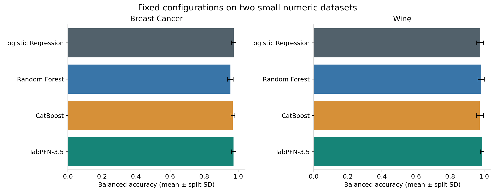
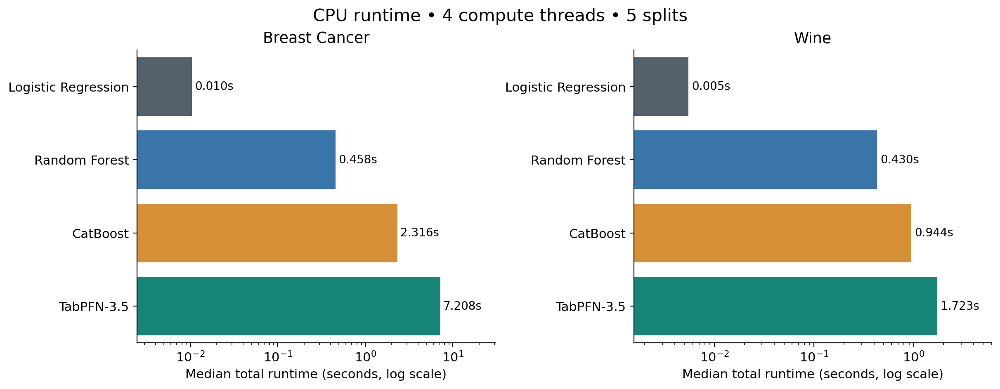

# TabPFN-3.5 vs Traditional Machine Learning

Companion code for **Can TabPFN-3.5 Compete With Traditional Machine Learning Models?**, by Cornellius Yudha Wijaya for [Non-Brand Data](https://www.nb-data.com/).

Compare the **base TabPFN-3.5 checkpoint**, Logistic Regression, Random Forest, and CatBoost on the Breast Cancer Wisconsin Diagnostic and Wine datasets bundled with scikit-learn. The notebook includes executed outputs for **40 evaluations: four models × two datasets × five stratified splits**.

## Start here

- [Executed comparison notebook](TabPFN_3_5_Comparison.ipynb)
- [Standalone Python comparison](run_comparison.py)
- [Recorded scores and runtimes](results/summary.csv)
- [Per-split results](results/per_split_results.csv)
- [Recorded environment and checkpoint hash](results/environment.json)

## Measured results

Balanced accuracy is the mean across five holdouts. Runtime is the median of construction + fit + first full-test probability prediction on an Intel Core i7-12700H CPU with four compute threads.

| Dataset | Model | Balanced accuracy | Log loss ↓ | Total time (s) |
|---|---|---:|---:|---:|
| Breast Cancer | Logistic Regression | 0.9734 | 0.0844 | 0.0104 |
| Breast Cancer | Random Forest | 0.9538 | 0.1200 | 0.4581 |
| Breast Cancer | CatBoost | 0.9677 | 0.0940 | 2.3160 |
| Breast Cancer | TabPFN-3.5 | 0.9722 | 0.0832 | 7.2083 |
| Wine | Logistic Regression | 0.9759 | 0.0799 | 0.0055 |
| Wine | Random Forest | 0.9815 | 0.1436 | 0.4304 |
| Wine | CatBoost | 0.9741 | 0.1017 | 0.9438 |
| Wine | TabPFN-3.5 | 0.9889 | 0.0248 | 1.7234 |

TabPFN led on Wine's mean balanced accuracy and had the lowest mean log loss on both datasets. Logistic Regression was slightly ahead on Breast Cancer's balanced accuracy and was the fastest model on both tasks. These are results for the fixed configurations below, not a universal ranking.





Charts by the author, generated from this experiment.

## Run the comparison

Use Python 3.11. Create a fresh environment in the repository root:

```bash
python -m venv .venv
```

Activate it with `.venv\Scripts\Activate.ps1` on Windows PowerShell, or `source .venv/bin/activate` on macOS/Linux. Then install the recorded direct dependency versions:

```bash
python -m pip install -r requirements.txt
```

Before the first TabPFN download, accept the model license at [Prior Labs](https://ux.priorlabs.ai) and configure `TABPFN_TOKEN` in your local environment. Never paste an access key into notebook cells, outputs, or a Git commit. Model weights are downloaded to `.model_cache/`, which Git ignores.

Run the standalone version from the repository root:

```bash
python run_comparison.py
```

Alternatively, open `TabPFN_3_5_Comparison.ipynb` in Jupyter or VS Code, select this environment's Python kernel, and run all cells in order. Restart the kernel before repeating the complete run. **A rerun replaces the recorded files in `results/` and the two charts in `images/`.** Save a copy first if you need to preserve the published measurements.

The package version is `tabpfn==9.1.0`; the model version is explicitly `ModelVersion.V3_5`. The selected checkpoint is `tabpfn-v3.5-20260909.safetensors`. Its SHA256 is recorded in the environment file. No model weights or credentials are distributed here. See the [official model card](https://huggingface.co/Prior-Labs/tabpfn_3_5) and [weight license](https://huggingface.co/Prior-Labs/tabpfn_3_5/blob/main/LICENSE); the model license is separate from the package code license.

## Protocol

- Five stratified 75/25 holdouts, seeds 42–46; the same row indices for every model within each split.
- Logistic Regression: training-only StandardScaler pipeline, L2, C=1, lbfgs, max_iter=2000.
- Random Forest: 300 trees; otherwise installed package defaults.
- CatBoost: 500 iterations, depth 6, learning rate 0.05.
- TabPFN-3.5: base checkpoint, four ensemble members, CPU, one preprocessing worker, fit_preprocessors mode.
- No tuning; sequential measurements after a separate small warmup, with a fresh estimator for each evaluation. Model order is shuffled deterministically within each split.
- Timing includes construction, fit (including cached-weight loading), and first full-test prediction. Imports, initial download, scoring, and file writes are excluded.
- Balanced accuracy is the primary metric. Accuracy, macro F1, log loss, and ROC AUC are also recorded. Binary AUC treats class 1 (benign) as positive; Wine uses macro one-vs-rest AUC.

## Inspect and verify the results

`results/` includes all 40 prediction files, split indices, data fingerprints, model settings, raw metrics, matching-split differences, and summaries. The notebook generates those files directly.

```bash
python verify_results.py
```

This recomputes metrics from the saved probabilities and checks the summaries, split membership, notebook syntax, and timing totals. Saved float32 probabilities can differ from a row sum of one by tiny rounding amounts; scikit-learn may report a warning when reading them back as float64.

## Limits

Both datasets are small, numeric, and complete. Five overlapping holdouts are not five independent experiments; mean ± split SD is descriptive, not a confidence interval. This comparison does not test categorical or text inputs, missing values, large datasets, tuned models, peak memory, GPU throughput, or production serving latency. Breast Cancer is used as a classification exercise, not evidence of clinical suitability. Use time-based or group-based splits when your own data requires them.

Results recorded October 11, 2026, Asia/Jakarta.
